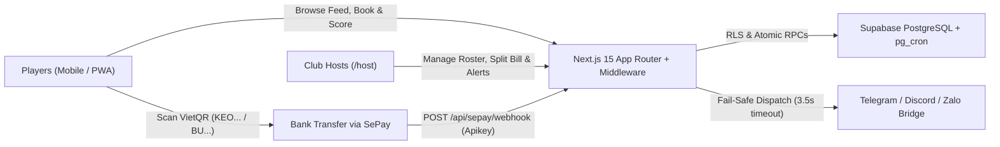

<div align="center">


# MatchMate

**Zero-friction match discovery, VietQR deposit reconciliation, live on-court scoring, and automated post-match split billing for Badminton & Pickleball clubs.**

[](https://nextjs.org/)
[](https://www.typescriptlang.org/)
[](https://tailwindcss.com/)
[](https://supabase.com/)
[](https://vitest.dev/)
[](https://vercel.com/)
[](#security--engineering-highlights)

[Live Demo](https://match-mate.phamduchieu.site) · [Features](#standout-features) · [Architecture](#architecture--tech-stack) · [Getting Started](#getting-started) · [Deployment](#vercel-deployment) · [Tiếng Việt](./README.vi.md)

</div>

---

## Overview

Badminton and Pickleball club hosts still lose hours every week managing messy Zalo/Facebook sign-up threads, checking bank transfer screenshots one by one, and calculating post-match court + shuttlecock bills in spreadsheets.

**MatchMate** replaces the entire workflow with a single mobile-first web app: players browse open sessions or join via a 6-character code without creating an account, pay deposits automatically via **SePay VietQR**, score sets courtside, and settle post-match balances (including male/female surcharges and Club Wallet carry-overs) in seconds.

---

## Standout Features

### Player Experience (Zero-Friction Booking)
- **Public Match Discovery & Weekly Calendar:** Browse upcoming `open` / `locked` sessions with sport (`Cầu lông`, `Pickleball`), skill level, and open-slot filters, or switch to a Monday–Sunday weekly calendar (`Asia/Ho_Chi_Minh`).
- **6-Character Quick Join:** Jump straight to any session ticket (`/keo/[short_code]`) by entering its 6-character code or pasting the invite link.
- **Accountless Instant Booking:** Reserve single or group slots with per-slot gender selection (`slot_genders`), Turnstile bot protection, idempotent submission, and a 4-digit self-cancel PIN.
- **Automated VietQR / SePay Deposits:** Dynamic `qr.sepay.vn` QR codes with unique `KEO...` transfer memos, live hold countdowns, atomic PostgreSQL slot locking, and `pg_cron` hold-expiry + waitlist promotion.
- **Waitlist & Self-Service Refunds:** Automatic waitlist promotion when spots open up, self-service cancellation before cutoff, and bank-account submission for automated refund tracking.
- **1-Tap Add to Calendar:** Download an RFC 5545 `.ics` invite (with `24h`, `12h`, and `1h` `VALARM` reminders plus venue & Google Maps link) or open directly in Google Calendar.

### On-Court Experience
- **Mobile-First Mini Scoreboard:** Run `1v1` Singles and `2v2` Doubles games restricted strictly to confirmed roster participants with non-duplicate player validation.
- **Multi-Set Scoring & Bulk Finish:** Increment/decrement set scores (`+1` / `-1`) courtside, add multiple sets, or bulk-finish in-progress matches in one tap.
- **Live Leaderboard & MVP:** Real-time session standings tracking games played (`GP`), `W-L`, `Win%`, point differential (`+/-`), and automatic **MVP** ranking.
- **Client-Side Match Recap Cards:** Export `1080×1350` dark-volt PNG recap cards rendered on HTML5 Canvas 2D — ready to drop straight into Zalo or Facebook club chats with zero CORS/font failures.

### Host Operations & Finance
- **Actionable Admin Dashboard:** 4 live KPIs (*Open Matches*, *Confirmed Slots*, *Collected Revenue*, *Action Required*), `Upcoming` / `Past` / `All` filters, quick `+7d` match cloning, camera-based QR check-in (`jsQR`), and full participant editing with per-person gender toggles.
- **Post-Match Split Bill & Club Wallet:** Formatted VND fee inputs, shuttlecock unit price × count, extras fee, and configurable Male/Female surcharge (`0–200%`). Auto-generates `BU...` VietQR top-up codes for deficits (reconciled automatically via SePay webhook) and credits surpluses to each player's **Club Wallet** ledger.
- **Real-Time Host Notifications:** Instant alerts for new bookings, confirmed payments, late cancellations, and refund requests via **Telegram Bot**, **Discord Webhook**, or **Zalo Webhook/OA Bridge**.
- **1-Click Shareable Roster Posters:** Generate a `1080×1350` dark-volt PNG roster poster embedded with a scannable `/keo/[short_code]` booking QR code.

---

## Architecture & Tech Stack

| Layer | Technology | Role |
| :--- | :--- | :--- |
| **Framework** | Next.js `15.5.29` (App Router) · React `19.3.1` | Server Components, API Route Handlers, Middleware, Dynamic OG images |
| **Language** | TypeScript `5.8.3` | End-to-end strict typing across client, server, and financial math |
| **Styling & UI** | Tailwind CSS `3.4.17` · `lucide-react` · `next-themes` | Athletic Ticket UI with Light / Dark / System theme support |
| **Database & Auth** | Supabase (`@supabase/supabase-js` `2.119.2`, `@supabase/ssr` `0.12.7`) | PostgreSQL, Row Level Security (RLS), `SECURITY DEFINER` RPCs, `pg_cron` |
| **Payments** | SePay Inbound Webhooks · `qr.sepay.vn` VietQR | Multi-host bank routing, `KEO...` deposits & `BU...` split-bill top-ups |
| **Media & QR** | HTML5 Canvas 2D · `qrcode` `1.5.4` · `jsqr` `1.4.0` | Client-side PNG Recap Cards/Posters & camera QR check-in scanner |
| **Security** | Cloudflare Turnstile · PostgreSQL Rate Limiter | Bot protection, `HttpOnly` pass cookies, timing-safe webhook auth, CSP |
| **Testing** | Vitest `4.1.12` · `tsx` `4.23.1` | 8 unit test suites (49 tests) + SQL acceptance & concurrency scripts |



---

## Security & Engineering Highlights

- **Defense-in-Depth Database Access:** All tables enforce **PostgreSQL RLS** with column-level `GRANT` restrictions (`anon` never receives player phone numbers or `host_id`), while state mutations run inside `SECURITY DEFINER` atomic RPCs (`host_delete_match`, `check_rate_limit`, and booking/reconciliation RPCs).
- **Cookie-Backed Player Sessions & Hardened Headers:** Player pass tokens (`?t=`) are exchanged in `src/middleware.ts` into `HttpOnly`, `Secure`, `SameSite=Lax` cookies (`kt_<id>`) and stripped from URLs; `next.config.ts` enforces HSTS, `X-Frame-Options: DENY`, `X-Content-Type-Options: nosniff`, `no-referrer` on `/dang-ky/*`, and a strict Content Security Policy.
- **CSRF, Rate Limiting & Webhook Integrity:** Host mutations validate `Origin` against `NEXT_PUBLIC_SITE_URL` (`verifyHostOrigin`), public routes enforce atomic PostgreSQL rate limits (`check_rate_limit`) and Cloudflare Turnstile verification, and `/api/sepay/webhook` verifies `Authorization: Apikey` via constant-time `crypto.timingSafeEqual` with multi-host account matching.
- **SSRF-Safe Notification Adapters:** `src/lib/notifications.ts` validates Telegram tokens/chat IDs, Discord webhook domains, and HTTPS URLs (blocking `localhost` and private IP ranges), dispatching alerts via `Promise.allSettled` with `3.5s` timeouts so notification failures never block bookings or webhooks.
- **Bilingual i18n & Verified Test Suite:** Full Vietnamese/English dictionary switching (`LocaleProvider` with `vi.ts` / `en.ts`), PWA manifest/service worker, and `8` Vitest suites (`49` passing unit tests) covering calendar `.ics` generation, split-bill surcharge math, scoreboard MVP rules, validation, formatting, and notification adapters.

---

## Project Structure

```text
MatchMate/
├── public/
│   ├── icons/                        # PWA app icons (icon-192.png, icon-512.png)
│   ├── manifest.json                 # Installable PWA manifest
│   └── sw.js                         # Service worker for static asset caching
├── scripts/
│   ├── concurrency_test.ts           # Parallel booking race-condition verification
│   └── provision_host.ts             # CLI helper to create/promote a host account
├── supabase/
│   ├── migrations/
│   │   ├── 001_schema.sql            # Core tables (matches, registrations, payments, refunds, audit_log)
│   │   ├── 002_rls_and_grants.sql    # RLS policies, column grants & is_match_host()
│   │   ├── 003_booking_and_payment_rpcs.sql
│   │   ├── 004_cancel_and_host_rpcs.sql
│   │   ├── 005_read_rpcs_and_cron.sql
│   │   ├── 006_group_booking_and_flexible_slots.sql
│   │   ├── 007_court_numbers_and_match_edit.sql
│   │   ├── 008_security_hardening.sql
│   │   ├── 009_matchmate_v4_upgrade.sql   # match_games, match_settlements, club_wallet_ledger, notifications
│   │   ├── 010_fix_v4_service_role_grants.sql
│   │   └── 011_gender_split_bill.sql      # slot_genders & male_surcharge_percent
│   └── tests/
│       └── acceptance_tests.sql      # Transactional SQL acceptance test suite
├── tests/                            # Vitest unit tests (8 files, 49 tests)
└── src/
    ├── middleware.ts                 # ?t= -> HttpOnly cookie exchange & Supabase SSR session refresh
    ├── app/
    │   ├── page.tsx                  # Public Match Discovery Feed & Weekly Calendar
    │   ├── keo/[short_code]/         # Public session ticket, Mini Scoreboard & dynamic OG card
    │   ├── dang-ky/[id]/             # Digital booking pass, VietQR, Calendar export & self-cancel
    │   ├── host/                     # Host login, KPI dashboard, create session & match detail tabs
    │   └── api/                      # Public, booking, SePay webhook, scoreboard & host APIs
    ├── components/
    │   ├── player/                   # HomeDiscoveryClient, MatchClient, BookingSheet, RegistrationTracker
    │   ├── host/                     # HostDashboardClient, MatchDetailTabs, SplitBillPanel, RosterPosterModal, QrCheckinModal
    │   └── shared/                   # MiniScoreboardTab
    └── lib/
        ├── i18n/                     # LocaleProvider & vi/en dictionaries
        ├── supabase/                 # Browser, SSR server & service-role admin clients
        ├── calendar.ts               # RFC 5545 .ics (with 3 VALARMs) & Google Calendar builder
        ├── canvas-exports.ts         # 1080x1350 Match Recap Card & Roster Poster PNG renderers
        ├── host-payment-config.ts    # Multi-host SePay & bank routing config resolver
        ├── notifications.ts          # SSRF-safe Telegram, Discord & Zalo notification adapters
        ├── rate-limit.ts             # Atomic PostgreSQL rate limiter helper
        ├── scoreboard.ts             # 1v1/2v2 roster validation, leaderboard & MVP logic
        ├── sepay.ts                  # VietQR URL builder & Turnstile verification
        ├── split-bill.ts             # Gender-weighted split bill & Club Wallet math
        └── validation.ts             # Phone normalization, CSRF Origin & SePay payload checks
```

---

## Getting Started

### Prerequisites

- **Node.js `20+`** and **`pnpm`**
- A **Supabase** project with **`pg_cron`** enabled (and public Email Sign-ups disabled)
- **Cloudflare Turnstile** site/secret keys (for booking spam protection)
- A **SePay** account (optional for local UI development; required for live VietQR webhooks)

### 1. Clone & Install

```bash
git clone https://github.com/phamduchieu3112/MatchMate.git
cd MatchMate
pnpm install
```

### 2. Configure Environment Variables

Copy `.env.example` to `.env.local` and fill in your credentials (never commit `.env.local`):

```bash
cp .env.example .env.local
```

| Variable | Required | Example / Placeholder | Purpose |
| :--- | :---: | :--- | :--- |
| `NEXT_PUBLIC_SUPABASE_URL` | Yes | `https://your-project-ref.supabase.co` | Supabase project URL |
| `NEXT_PUBLIC_SUPABASE_ANON_KEY` | Yes | `your-supabase-anon-key` | Public RLS-scoped Supabase anon key |
| `SUPABASE_SERVICE_ROLE_KEY` | Yes | `your-supabase-service-role-key` | Server-only service role key (webhooks & RPCs) |
| `NEXT_PUBLIC_SITE_URL` | Yes | `http://localhost:3000` | Canonical origin for CSRF checks, links & OG metadata |
| `NEXT_PUBLIC_TURNSTILE_SITE_KEY` | Yes | `your-turnstile-site-key` | Public Cloudflare Turnstile widget site key |
| `TURNSTILE_SECRET_KEY` | Yes | `your-turnstile-secret-key` | Server-side Turnstile verification secret |
| `SEPAY_WEBHOOK_API_KEY` | Yes* | `your-sepay-webhook-api-key` | Shared secret for `Authorization: Apikey <key>` |
| `SEPAY_BANK_ACCOUNT` | Yes* | `0123456789` | Receiving bank account number for VietQR & webhook check |
| `SEPAY_BANK_NAME` | Yes* | `MBBank` | Bank code used by `qr.sepay.vn` |
| `SEPAY_ACCOUNT_NAME` | No | `NGUYEN VAN A` | Account holder name shown on payment screens |
| `SEPAY_API_TOKEN` | No | `your-optional-sepay-api-token` | Optional SePay API token |
| `PAYMENT_CODE_PREFIX` | No | `KEO` | Transfer memo prefix for deposit matching (default `KEO`) |
| `HOST_PAYMENT_CONFIGS_JSON` | No | `{"host@example.com":{...}}` | Multi-host SePay & bank routing JSON map/array |
| `HOST_PAYMENT_FALLBACK_EMAIL` | No | `host@example.com` | Fallback host email when a host has no custom config |
| `HOST_PAYMENT_FALLBACK_MODE` | No | `default_host` | `default_host` or `strict` payment routing mode |
| `TELEGRAM_BOT_TOKEN` | No | `123456789:your-bot-token` | Optional env fallback if not set in Host UI |
| `TELEGRAM_CHAT_ID` | No | `-1001234567890` | Optional Telegram chat/channel ID fallback |
| `DISCORD_WEBHOOK_URL` | No | `https://discord.com/api/webhooks/...` | Optional Discord webhook URL fallback |
| `ZALO_WEBHOOK_URL` | No | `https://your-zalo-bridge.example.com/hook` | Optional Zalo OA / webhook bridge URL fallback |

*\*Required when enabling single-host SePay VietQR payments (or supply per-host configs via `HOST_PAYMENT_CONFIGS_JSON`).*

### 3. Apply Supabase Migrations & Provision a Host

1. In **Supabase Dashboard → Database → Extensions**, enable **`pg_cron`**.
2. In **Supabase Dashboard → SQL Editor**, execute every migration in exact order (`001` through `011`):
   - `001_schema.sql` → `002_rls_and_grants.sql` → `003_booking_and_payment_rpcs.sql` → `004_cancel_and_host_rpcs.sql` → `005_read_rpcs_and_cron.sql` → `006_group_booking_and_flexible_slots.sql` → `007_court_numbers_and_match_edit.sql` → `008_security_hardening.sql` → `009_matchmate_v4_upgrade.sql` → `010_fix_v4_service_role_grants.sql` → `011_gender_split_bill.sql`
3. Provision your organizer login account via CLI (PowerShell / Bash):

```bash
HOST_EMAIL="host@example.com" HOST_PASSWORD="StrongPassword123!" pnpm exec tsx --env-file=.env.local scripts/provision_host.ts
```

### 4. Run Locally & Verify

```bash
# Start development server
pnpm dev

# Run full verification suite
pnpm exec tsc --noEmit
pnpm lint
pnpm test
pnpm build
```

---

## Vercel Deployment

1. Import the GitHub repository into **Vercel** and configure the environment variables above with `NEXT_PUBLIC_SITE_URL` set to your production domain (e.g., `https://match-mate.phamduchieu.site`).
2. Configure your **SePay** inbound money-in webhook pointing to `https://<your-domain>/api/sepay/webhook` with `Authorization: Apikey <SEPAY_WEBHOOK_API_KEY>`.
3. Add a daily keep-alive check (e.g., `GET /api/health`) and Vercel WAF rate-limiting on `POST /api/book`.
4. See [MANUAL_SETUP_AND_DEPLOY.md](./MANUAL_SETUP_AND_DEPLOY.md) for the complete production checklist.

---

<div align="center">

Built by **[phamduchieu3112](https://github.com/phamduchieu3112)** · [Live App](https://match-mate.phamduchieu.site) · [Repository](https://github.com/phamduchieu3112/MatchMate)

</div>
